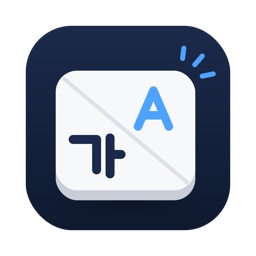

<p align="center"></p>

# 딸깍한영 (Ddalkkak)

한영키를 **누르는 순간** 한글 ↔ 영문이 바뀌는 macOS 메뉴 막대 앱입니다.

한영키를 누르고 바로 치면 첫 글자가 이전 언어로 찍히는 일, 딸깍한영을 쓰면 없어집니다.

```
한영키 → "안녕" 을 빠르게 입력
macOS 기본 :  dㅏㄴ녕   (첫 글자가 영어로 들어감)
딸깍한영   :  안녕
```

- 별도 입력기를 설치하지 않습니다. macOS 기본 한글 입력기와 ABC 를 그대로 씁니다.
- 다른 키 변환 프로그램이 필요 없습니다.
- 한영키로 쓸 키를 직접 고르고, 여러 개 등록할 수 있습니다. (예: 맥북에서는 오른쪽 ⌘, 외장 키보드에서는 한/영 키)

## 설치

1. [최신 릴리스](https://github.com/lhm7877/ddalkkak/releases/latest)에서 `Ddalkkak-1.1.zip` 을 받아 압축을 풉니다.
2. `Ddalkkak.app` 을 응용 프로그램 폴더로 옮깁니다.
3. 앱을 엽니다. Apple 공증을 받지 않은 앱이라 처음에는 macOS 가 실행을 막습니다.
   시스템 설정 > 개인정보 보호 및 보안 > 아래쪽의 **"그래도 열기"** 를 누릅니다.
   터미널이 편하면 아래 명령으로도 됩니다.
   ```bash
   xattr -dr com.apple.quarantine /Applications/Ddalkkak.app
   ```
4. 처음 실행하면 앱이 두 가지를 안내합니다.
   - **전환 단축키를 F17 로 바꿀까요?** → "F17 로 바꾸기" 를 권합니다. 앱이 알아서 설정합니다.
   - **손쉬운 사용 권한** → 설정 화면이 자동으로 열리고 목록에 딸깍한영이 올라와 있습니다. 스위치만 켜면 앱이 바로 동작을 시작합니다.
5. 메뉴 막대 아이콘을 눌러 **로그인 시 자동 실행**을 켭니다.

## 사용법

기본 한영키는 **오른쪽 ⌘** 와 **오른쪽 ⌥** 입니다. 메뉴 막대 아이콘을 누르면 아래 메뉴가 나옵니다.

| 메뉴 | 설명 |
|---|---|
| 한영키 사용 | 끄면 등록한 키가 원래 키로 동작합니다 |
| 한영키로 쓰는 키 | 등록된 키 목록. 클릭하면 제거됩니다 |
| 한영키 추가… | 누른 뒤 원하는 키를 한 번 누르면 등록됩니다 (Esc 로 취소) |
| 전환 단축키로 F17 사용 (권장) | macOS 의 "이전 입력 소스 선택" 단축키를 F17 로 바꿉니다. 끄면 macOS 기본값(⌃Space)으로 되돌립니다 |
| 로그인 시 자동 실행 | 로그인할 때 자동으로 켭니다 |

Caps Lock 과 fn(🌐) 키는 등록할 수 없습니다.

아이콘에 경고 표시가 뜨면 메뉴를 열어 보세요. 원인과 해결 버튼이 함께 나옵니다.

## 필요한 것

- macOS 13 이상 (Apple Silicon, Intel 모두 포함된 유니버설 앱)
- 입력 소스에 한글과 ABC 가 둘 다 있어야 합니다
- 손쉬운 사용 권한

## 알려진 한계

- 동작은 macOS 26.5 (Apple Silicon), 기본 한글 2벌식 + ABC 조합에서만 확인했습니다. 다른 버전과 Intel Mac 에서는 확인하지 못했습니다.
- 전환 단축키를 F17 로 바꾸지 않으면 빠르게 칠 때 전환이 빠질 수 있습니다.
- 암호 입력란에서는 동작하지 않습니다.
- 입력 소스가 셋 이상이면 최근에 쓴 두 개 사이를 오갑니다.
- macOS 설정에서 Caps Lock 을 ⌘ 로 바꿔 쓰는 경우, 그 키가 오른쪽 ⌘ 로 인식되어 한영키와 겹칠 수 있습니다. 메뉴에서 오른쪽 ⌘ 를 한영키 목록에서 빼면 됩니다.

## 문서

- [설치](https://github.com/lhm7877/ddalkkak/wiki/설치)
- [사용법](https://github.com/lhm7877/ddalkkak/wiki/사용법)
- [문제 해결](https://github.com/lhm7877/ddalkkak/wiki/문제-해결)

문제가 있으면 [이슈](https://github.com/lhm7877/ddalkkak/issues)로 알려 주세요. macOS 버전과 키보드 종류, 어떤 키를 한영키로 쓰는지 적어 주시면 도움이 됩니다.
