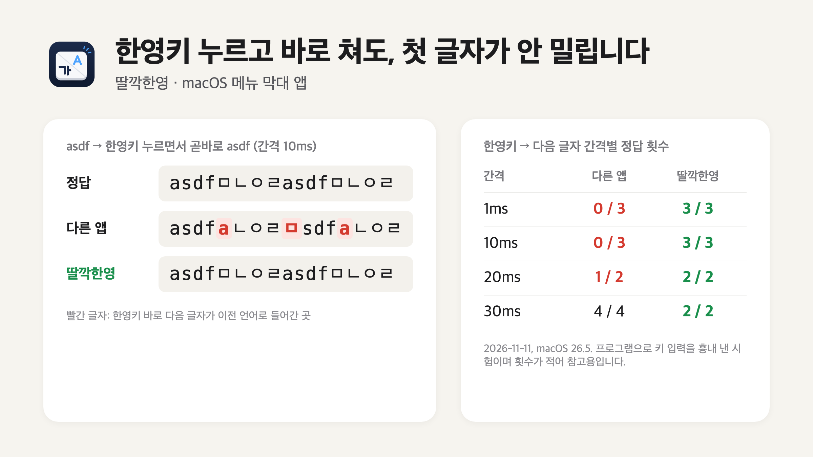

<p align="center"></p>

# 딸깍한영 (Ddalkkak)

지금 쓰는 맥 키보드에서 아래 글자를 **최대한 빠르게** 쳐 보세요.

```
ㅁㄴㅇㄹasdfㅁㄴㅇㄹasdfㅁㄴㅇㄹasdf
```

한글 상태에서 `asdf` 자리의 네 글자를 치고, 한영키를 누르자마자 다시 같은 네 글자를 치는 것을 반복하면 됩니다. `ㅁㄴㅇㄹㅁsdf` 나 `asdfaㄴㅇㄹ` 처럼 중간에 한 글자가 섞여 나왔다면 첫 글자가 밀린 것입니다. 딸깍한영은 이 한 글자를 없애려고 만든 앱입니다.

한영키를 **누르는 순간** 한글 ↔ 영문이 바뀌는 macOS 메뉴 막대 앱입니다.

한영키를 누르고 바로 치면 첫 글자가 이전 언어로 찍히는 일, 딸깍한영을 쓰면 없어집니다.

```
한영키 → "안녕" 을 빠르게 입력
macOS 기본 :  dㅏㄴ녕   (첫 글자가 영어로 들어감)
딸깍한영   :  안녕
```

- 별도 입력기를 설치하지 않습니다. macOS 기본 한글 입력기와 ABC 를 그대로 씁니다.
- 다른 키 변환 프로그램이 필요 없습니다.
- 한영키로 쓸 키를 직접 고르고, 여러 개 등록할 수 있습니다. (예: 맥북에서는 오른쪽 ⌘, 외장 키보드에서는 한/영 키)
- Caps Lock 도 한영키로 쓸 수 있습니다. 길게 누르면 대소문자 고정이 됩니다.
- 한글 상태에서 ₩ 대신 `` ` `` 입력, Esc 를 누르면 영문으로 전환 같은 편의 기능이 있습니다.

## 왜 만들었나

"누르는 순간 전환"을 내세우는 기존 방법들을 써 봤지만, 한영키를 누르면서 곧바로 글자를 치면 **첫 글자가 이전 언어로 밀리는 일**이 여전히 있었습니다. 빠르게 칠수록 한영키와 다음 글자를 거의 겹쳐 누르게 되는데, 그때마다 지우고 다시 쳐야 했습니다. 이 한 글자를 없애려고 딸깍한영을 만들었습니다.

### 비교 시험

<p align="center"></p>

같은 Mac 에서, 비슷한 기능의 다른 앱 1종(기본 설정)과 딸깍한영에 똑같은 입력을 넣어 비교했습니다. (2026-11-11, macOS 26.5, Apple Silicon)

- 입력: `asdf` → 한영키를 누른 채 곧바로 `asdf` → 이것을 3번 반복
- 정답: `asdfㅁㄴㅇㄹasdfㅁㄴㅇㄹ`
- "간격"은 한영키를 누른 뒤 다음 글자를 누르기까지의 시간입니다.

| 간격 | 다른 앱 | 딸깍한영 |
|---|---|---|
| 1ms | 0 / 3 | 3 / 3 |
| 10ms | 0 / 3 | 3 / 3 |
| 20ms | 1 / 2 | 2 / 2 |
| 30ms | 4 / 4 | 2 / 2 |
| 60ms | 1 / 2 | 2 / 2 |

다른 앱이 틀릴 때는 대부분 아래처럼 한영키 바로 다음 한 글자가 이전 언어로 들어갔습니다.

```
정답     :  asdfㅁㄴㅇㄹasdfㅁㄴㅇㄹ
다른 앱  :  asdfaㄴㅇㄹㅁsdfaㄴㅇㄹ
딸깍한영 :  asdfㅁㄴㅇㄹasdfㅁㄴㅇㄹ
```

간격이 30ms 이상이면 다른 앱도 대체로 맞습니다. 차이는 한영키와 다음 글자를 아주 빠르게 이어 칠 때 납니다. 프로그램으로 키 입력을 흉내 낸 시험이며, 횟수가 적어 참고용입니다.

## 설치

### Homebrew

```bash
brew install --cask lhm7877/tap/ddalkkak
```

설치한 뒤 응용 프로그램 폴더의 딸깍한영을 열고, 아래 3번부터 따라 하면 됩니다.

### 직접 설치

1. [최신 릴리스](https://github.com/lhm7877/ddalkkak/releases/latest)에서 `Ddalkkak-1.3.zip` 을 받아 압축을 풉니다.
2. `Ddalkkak.app` 을 응용 프로그램 폴더로 옮깁니다.
3. 앱을 엽니다. Apple 공증을 받지 않은 앱이라 처음에는 macOS 가 실행을 막습니다.
   시스템 설정 > 개인정보 보호 및 보안 > 아래쪽의 **"그래도 열기"** 를 누릅니다.
   터미널이 편하면 아래 명령으로도 됩니다.
   ```bash
   xattr -dr com.apple.quarantine /Applications/Ddalkkak.app
   ```
4. 처음 실행하면 앱이 두 가지를 안내합니다.
   - **전환 단축키를 F17 로 바꿀까요?** → "F17 로 바꾸기" 를 권합니다. 앱이 알아서 설정합니다.
   - **손쉬운 사용 권한** → 설정 화면이 자동으로 열리고 목록에 딸깍한영이 올라와 있습니다. 스위치만 켜면 앱이 바로 동작을 시작합니다.
5. 메뉴 막대 아이콘을 눌러 **로그인 시 자동 실행**을 켭니다.

## 사용법

기본 한영키는 **오른쪽 ⌘** 와 **오른쪽 ⌥** 입니다. 메뉴 막대 아이콘을 누르면 아래 메뉴가 나옵니다.

| 메뉴 | 설명 |
|---|---|
| 한영키 사용 | 끄면 등록한 키가 원래 키로 동작합니다 |
| 한영키로 쓰는 키 | 등록된 키 목록. 클릭하면 제거됩니다 |
| 한영키 추가… | 누른 뒤 원하는 키를 한 번 누르면 등록됩니다 (Esc 로 취소) |
| 전환 단축키로 F17 사용 (권장) | macOS 의 "이전 입력 소스 선택" 단축키를 F17 로 바꿉니다. 끄면 macOS 기본값(⌃Space)으로 되돌립니다 |
| Caps Lock 을 ⌘ 로 쓰기 | 모든 키보드에서 Caps Lock 을 ⌘ 로 씁니다. 아래의 "왼쪽 ⌘ 는 Caps Lock 으로 쓰기" 를 함께 켜면 두 키를 맞바꿉니다. 앱을 종료하면 원래대로 돌아갑니다 |
| Caps Lock 을 한영키로 쓰기 | Caps Lock 을 한영키로 씁니다. "한영키 추가…" 에서 Caps Lock 을 눌러도 켜집니다. "Caps Lock 을 ⌘ 로 쓰기" 와는 함께 켤 수 없습니다 |
| 길게 누르면 대소문자 고정 | Caps Lock 한영키를 0.5초쯤 누르고 있으면 영문 상태에서 대소문자 고정을 켜거나 끕니다 |
| 한글 상태에서 ₩ 대신 `` ` `` 입력 | 한글 상태에서도 ₩ 키로 `` ` `` 를 입력합니다. ₩ 는 ⌥₩ 로 입력합니다 |
| Esc 를 누르면 영문으로 | 한글 상태에서 Esc 를 누르면 영문으로 바뀝니다. Esc 는 원래대로도 동작합니다 |
| 로그인 시 자동 실행 | 로그인할 때 자동으로 켭니다 |
| 새 버전 확인 | 새 버전이 나오면 메뉴 맨 위에 알려 줍니다 |

fn(🌐) 키는 한영키로 등록할 수 없습니다.

아이콘에 경고 표시가 뜨면 메뉴를 열어 보세요. 원인과 해결 버튼이 함께 나옵니다.

## 필요한 것

- macOS 13 이상 (Apple Silicon, Intel 모두 포함된 유니버설 앱)
- 입력 소스에 한글과 ABC 가 둘 다 있어야 합니다
- 손쉬운 사용 권한

## 개인정보

딸깍한영은 입력한 글자를 저장하거나 어디로도 보내지 않습니다. 인터넷 접속은 새 버전 확인 하나뿐입니다. 실행할 때와 하루에 한 번 이 저장소의 최신 릴리스 번호를 GitHub 에서 읽어 오며, 보내는 정보는 없습니다. 메뉴의 "새 버전 확인" 을 끄면 접속하지 않습니다.

## 알려진 한계

- 동작은 macOS 26.5 (Apple Silicon), 기본 한글 2벌식 + ABC 조합에서만 확인했습니다. 다른 버전과 Intel Mac 에서는 확인하지 못했습니다.
- 전환 단축키를 F17 로 바꾸지 않으면 빠르게 칠 때 전환이 빠질 수 있습니다.
- 암호 입력란에서는 동작하지 않습니다.
- Caps Lock 한영키는 1.3 에서 새로 넣은 기능이라 여러 키보드에서 충분히 확인하지 못했습니다. 이상하면 이슈로 알려 주세요.
- 입력 소스가 셋 이상이면 최근에 쓴 두 개 사이를 오갑니다.
- macOS 설정(키보드 > 보조 키)에서 Caps Lock 을 ⌘ 로 바꿔 두면 한영키(오른쪽 ⌘)와 겹칩니다. 보조 키를 기본값으로 되돌리고 메뉴의 "Caps Lock 을 ⌘ 로 쓰기" 를 켜세요.

## 문서

- [설치](https://github.com/lhm7877/ddalkkak/wiki/설치)
- [사용법](https://github.com/lhm7877/ddalkkak/wiki/사용법)
- [문제 해결](https://github.com/lhm7877/ddalkkak/wiki/문제-해결)

문제가 있으면 [이슈](https://github.com/lhm7877/ddalkkak/issues)로 알려 주세요. macOS 버전과 키보드 종류, 어떤 키를 한영키로 쓰는지 적어 주시면 도움이 됩니다.
